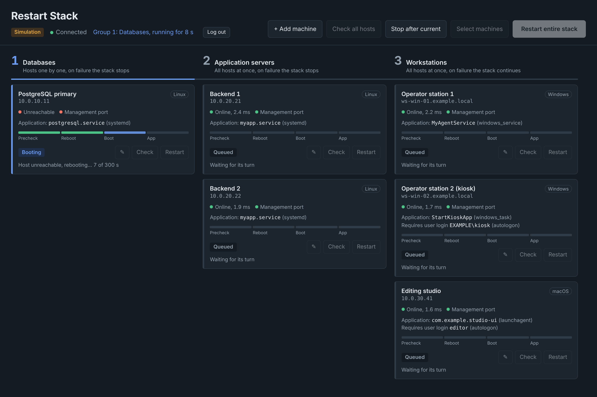

# Restart Orchestrator

A FastAPI web application for remotely restarting a fleet of Linux, macOS and Windows machines in stages, guaranteeing that applications auto-start after boot, with real-time status.

Follows the flow: **OS config → per-group machine queue → status visualizer → failure handling.**

> This is a personal/portfolio project. It ships with fictional demo data (`config.example.json`) — real addresses, logins and passwords live only in the git-ignored `config.json` / `secrets.json`.

## Project structure

```
restart-orchestrator/
├── config.example.json          # template: hosts, groups (stack stages), settings
├── secrets.example.json         # template: passwords keyed by host id
├── tests/                       # pytest: config, orchestrator, API
├── .github/                     # CI, Dependabot, PR and issue templates
├── CHANGELOG.md
├── requirements.txt
├── .env.example                 # secrets: UI login, WinRM passwords, Zabbix token
├── app/
│   ├── main.py                  # FastAPI: REST API, SSE stream, authentication
│   ├── config.py                # Pydantic models and config.json validation
│   ├── state.py                 # in-memory host/stack status + pub/sub for the UI
│   ├── orchestrator.py          # per-group queue, host lifecycle, fail-safe
│   ├── monitoring.py            # ICMP ping, management port, Zabbix API
│   ├── check.py                 # CLI: python -m app.check — check without reboot
│   ├── selfdetect.py            # detect the orchestrator's own machine
│   ├── alerts.py                # webhook alerts (Slack/Mattermost)
│   ├── logging_setup.py         # log to console and a rotating file
│   ├── vault.py / crypto.py / setpass.py  # optional master-password encryption
│   ├── executors/
│   │   ├── base.py              # common interface
│   │   ├── ssh.py               # Linux (systemd) and macOS (launchd) via paramiko
│   │   ├── winrm_exec.py        # Windows: services and Task Scheduler via WinRM
│   │   └── simulated.py         # simulation for dry_run
│   └── static/index.html        # web UI (no build step, vanilla JS)
└── deploy/
    ├── linux/myapp.service, sudoers.example
    ├── macos/com.example.myapp.plist, sudoers.example
    ├── windows/setup-winrm.ps1, register-app-autostart.ps1
    └── restart-orchestrator.service   # systemd unit for the orchestrator itself
```

## Testing against real hosts

The orchestrator runs on one control machine and reboots the others. It will not reboot itself: on startup it compares this machine's addresses and name against the hosts in the config and marks the matching host as "not rebooted". If the orchestrator runs in Docker or behind NAT and auto-detection does not work, list such hosts in `settings.exclude_host_ids`.

First-run sequence:

1. `cp config.example.json config.json` and `cp secrets.example.json secrets.json && chmod 600 secrets.json`. Fill in real addresses and passwords. Start with one machine per OS.
2. Check without rebooting — works even with `dry_run: true`:
   ```bash
   python -m app.check            # all hosts
   python -m app.check ws-win-01  # one
   ```
   It verifies connectivity, passwords, sudo/administrator rights, the service's presence, autostart and autologon — changing nothing on the machines. Get every host to pass. The same is available in the UI via the "Check" buttons.
3. Set `"dry_run": false`, start the web UI, and reboot one non-critical machine with its button. Watch the log.
4. Rehearse failures on a test machine: stop and disable the application service, change the autologon password, drop the network during boot. Each time the host should get a clear error status.
5. Only then — "Restart entire stack" on a test group.

## Passwords: each machine has its own

Passwords live in `secrets.json` next to the config, keyed by the host `id` (see `secrets.example.json`). The file is in `.gitignore`, and the orchestrator warns if its permissions are wider than `600`.

```json
{
  "app-01":    {"sudo_password": "..."},
  "ws-win-01": {"password": "..."},
  "mac-01":    {"password": "...", "sudo_password": "..."}
}
```

Keys: `password` (SSH or WinRM), `sudo_password`, `ssh_key_passphrase`. An environment variable named in `*_env` in the config takes priority over the file. Passwords never reach the UI, the API, or the logs.

**Password sudo (Linux, macOS).** If `sudo_password` is set, commands run as `sudo -S` with the password passed via stdin, so it never appears on the command line or in the process list. If no password is set, `sudo -n` is used and the NOPASSWD rules from `deploy/*/sudoers.example` are required. For production, NOPASSWD on specific commands is safer: the sudo password need not be stored at all.

### Optional: encrypting machine passwords

For production you can encrypt the passwords in `secrets.json` with a master password (AES-256-GCM, scrypt KDF). The master password is stored nowhere — it is entered once in the web UI and wiped from memory after a period of inactivity. SSH-key machines keep working while locked; password-based (Windows) machines require the master password to be entered.

```bash
python -m app.setpass enable        # set the master password, encrypt existing passwords
python -m app.setpass status        # show the encryption state
python -m app.setpass set <host>    # set/change a machine password
python -m app.setpass rekey         # change the master password
python -m app.setpass disable       # decrypt back to plaintext
```

## The login screen after reboot

SSH and WinRM start responding at the login screen already, so the orchestrator sees the OS boot without a user logging in. The only question is the application.

- **The app does not need a desktop** (service, agent, server): run it as a Windows service or a LaunchDaemon. They start before any user logs in, so the login screen is no obstacle. This is the preferred option.
- **The app needs a desktop** (window, kiosk, dashboard): set up autologon and start-on-login, and in the config set `"requires_user_session": true` and `"session_user"`. Before the reboot the orchestrator verifies autologon is configured; after boot it waits for the login (`login_timeout_seconds`) and only then checks the application.
  - Windows: Sysinternals Autologon + an "At log on" task, see `deploy/windows/setup-autologon.md`.
  - macOS: "Automatically log in as" + a LaunchAgent (`"app_service_type": "launchagent"`), example in `deploy/macos/com.example.studio-ui.plist`.

The orchestrator does not type the password at the login screen: it cannot be entered remotely by ordinary means.

**FileVault on a Mac** blocks both options: after reboot the Mac waits for the disk-unlock password before the system even boots, with no network. The precheck rejects such Macs with an explanation. **BitLocker with a PIN** on Windows behaves the same way. BitLocker with TPM only (the default) is fine.

## Quick start (simulation)

`config.json` defaults to `"dry_run": true`: real machines are left untouched, hosts are emulated (with failure probability `dry_run_failure_rate`), so you can exercise the UI and every failure scenario.

```bash
python3 -m venv venv && source venv/bin/activate
pip install -r requirements.txt
cp config.example.json config.json   # config.json is in .gitignore: real addresses stay out of git
export ADMIN_USER=admin ADMIN_PASSWORD='a-long-random-password'
uvicorn app.main:app --host 0.0.0.0 --port 8000 --workers 1
```

Open http://localhost:8000. Important: **only `--workers 1`**, because the queue and status live in the process memory.

## How a single host restart works

```
precheck → ensure autostart → reboot → waiting_boot → starting_app → success | failed
```

1. **Precheck.** Connection, privileges (sudo NOPASSWD / Windows administrator), service presence. The boot marker is recorded: `boot_id` on Linux, `kern.boottime` on macOS, `LastBootUpTime` on Windows.
2. **Autostart.** Before the reboot the app is set to autostart via the OS's own mechanism: `systemctl enable`, `launchctl enable` + a `RunAtLoad` check, `StartupType Automatic`, or a scheduled task with an AtStartup trigger.
3. **Reboot.** The command is sent in the background (`nohup … systemctl reboot`, `shutdown /r /t 5`) so the session closes cleanly.
4. **Wait for boot.** Polled every `poll_interval_seconds` up to `timeout_seconds`. Success counts only when the boot marker changes: a ping reply does not prove a reboot happened.
5. **Application check.** Waits `app_start_timeout_seconds` for the normal autostart; if the service does not come up, `app_start_retries` manual start attempts follow. When `app_health_port` is set, readiness is detected by that port opening rather than via WinRM — much faster on freshly booted Windows machines.

Every blocking call (SSH/WinRM) runs in a thread pool via `asyncio.to_thread`, so the web server is never blocked.

## Failure strategy (fail-safe)

| Situation | Behavior |
|---|---|
| No access, privileges, or service | `failed / precheck`, **no reboot is performed** |
| Could not enable autostart | `failed / autostart`, no reboot is performed |
| Host is the orchestrator's own machine | not rebooted, button disabled |
| Nobody logged in within `login_timeout_seconds` | `failed / login`: the machine waits for a password at the login screen |
| Host did not return within `timeout_seconds` | `failed / boot_timeout`, the message says whether the host went into reboot |
| Application did not start | retries, then the service log goes to the log and `failed / app` |
| Error in a group with `on_failure: halt` | the following hosts and groups are marked `skipped`, the stack stops |
| Error in a group with `on_failure: continue` | the stack continues, final result `partial` |
| "Stop after current" button | soft stop: started hosts are allowed to finish, new ones do not start |

There are no automatic re-reboots, by design: this protects against reboot loops, and the decision to retry is made by a human (the per-host button). Every failure is written to the UI log, to `logs/orchestrator.log` (rotation 10 MB × 5), and sent to `alert_webhook_url` if configured.

Group recommendation: put databases and infrastructure in the first groups with `mode: sequential` and `on_failure: halt`; dependent application servers next, `parallel` + `halt`; workstations last, `parallel` + `continue`.

## Host configuration

| Field | Description |
|---|---|
| `id` | unique identifier (Latin letters, digits, `-_.`) |
| `name`, `hostname` | display name and IP/DNS |
| `os` | `linux`, `windows`, `mac` |
| `user` | user (for Windows you can use `DOMAIN\\user`) |
| `credentials` | `ssh_key` (path); passwords — in `secrets.json` or via `password_env`, `sudo_password_env`, `ssh_key_passphrase_env` |
| `port` | defaults to 22 / 5985 / 5986 (with `winrm_https: true`) |
| `timeout_seconds` | how long to wait for the OS to boot |
| `app_service_name` | systemd unit (`myapp.service`), launchd label, Windows service name, or scheduled task |
| `app_service_type` | `systemd`, `launchd`, `launchagent`, `windows_service`, `windows_task` (defaults are chosen by OS) |
| `app_health_port` | optional app port for a readiness check (e.g. `30020`) |
| `app_process_name` | optional process name to verify the app is running (Windows) |
| `app_start_timeout_seconds` | how long to wait for the normal autostart |
| `requires_user_session`, `session_user` | the app needs a user login (Windows/macOS) and who should log in |
| `login_timeout_seconds` | how long to wait for autologon after the OS boots |
| `winrm_transport`, `winrm_https`, `winrm_verify_ssl` | WinRM parameters |

Group: `name`, `order` (stage order), `mode` (`sequential` / `parallel`), `on_failure` (`halt` / `continue`), `hosts`.

## Preparing hosts

**Linux.** Create a `restartbot` user, put the public key in `~/.ssh/authorized_keys`, configure sudo per `deploy/linux/sudoers.example`, and run the app as a systemd unit (`deploy/linux/myapp.service`). The sudoers file allows only specific commands, so the unit name in the config must match exactly (with `.service`).

**macOS.** Enable "Remote Login" (SSH), configure sudo per `deploy/macos/sudoers.example`, and run the app as a LaunchDaemon with `RunAtLoad` (`deploy/macos/com.example.myapp.plist`).

**Windows.** Run `deploy/windows/setup-winrm.ps1`, restrict the firewall to the orchestrator server's address, and use an HTTPS listener in production. Run the app as a service (NSSM/WinSW for ordinary exes) or a scheduled task with an "At startup" trigger (`deploy/windows/register-app-autostart.ps1`). The password is passed via the environment variable named in `password_env`.

**SSH known_hosts.** Strict host-key checking is on by default. Populate the file in advance:

```bash
ssh-keyscan -H 10.0.10.11 10.0.20.21 10.0.20.22 10.0.30.41 >> ~/.ssh/known_hosts
```

## Production mode

1. Verify each host one by one in simulation, then set `"dry_run": false`.
2. Start with a manual restart of one non-critical machine via its button.
3. A mass restart in production requires typing `RESTART` in the confirmation dialog.

## Machine editor

Machines can be added, edited and deleted right in the web UI: the "+ Add machine" button at the top and the pencil button on each machine. The form validates every field (you cannot enter an invalid IP, an extra field, an application type that does not fit the OS, and so on). Passwords are saved only to `secrets.json`, never to `config.json`. Changes apply immediately, without restarting the program. The list cannot be changed during an active restart — wait for it to finish. Editing is restricted to the `admin` role.

## API

| Method | Path | Description |
|---|---|---|
| GET | `/api/state` | full state snapshot |
| GET | `/api/stream` | Server-Sent Events: `snapshot`, `host`, `stack`, `event` |
| POST | `/api/stack/restart` | restart the whole stack (optionally `{"host_ids": [...]}`) |
| POST | `/api/stack/cancel` | soft-stop the stack |
| POST | `/api/hosts/{id}/restart` | restart a single host |
| POST | `/api/check`, `/api/hosts/{id}/check` | check without reboot |
| GET | `/healthz` | liveness probe (no auth) |

Authentication is session-based: log in at `/login` (or `POST /api/login`), which sets an `httponly` cookie. POST requests also require the `X-Requested-With: restart-ui` header (CSRF protection):

```bash
# log in and keep the session cookie, then call the API with it
curl -c cookies.txt -H 'Content-Type: application/json' \
     -d '{"user":"admin","password":"pass"}' http://localhost:8000/api/login
curl -b cookies.txt -H 'X-Requested-With: restart-ui' \
     -X POST http://localhost:8000/api/hosts/app-01/restart
```

## Deployment

Use `deploy/restart-orchestrator.service` and keep secrets in `/etc/restart-orchestrator.env` (`chmod 600`). Put the orchestrator behind nginx with HTTPS and do not expose it to the internet: this is a tool that can reboot your entire infrastructure. For nginx, disable buffering for `/api/stream` (`proxy_buffering off;`).

A single-file Windows executable can be built with PyInstaller (`build_exe.bat` / `build.spec`) so the control PC needs no Python.

## Development

```bash
pip install -r requirements-dev.txt
ruff check .
pytest -q
```

Tests use simulation mode and need no real hosts. GitHub Actions CI runs them on every push and pull request.

## Limitations and possible additions

- State is in memory: if the orchestrator itself restarts, the current run is lost (machines already rebooting will come up on their own). SQLite could be added for run history.
- For a Windows scheduled task the `Running` state is checked: the task must keep the application process alive, not start it and exit.
- Possible extensions: an automatic Zabbix maintenance window (`maintenance.create`) during a restart, an HTTP health check of the application instead of a service-status check, more user roles.

## License

MIT — see `LICENSE`.
